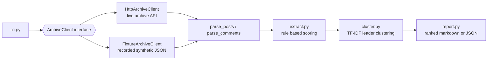

# reddit-pain-miner

Founders and marketers read hundreds of forum threads to learn what customers complain about, then lose the findings in a notes file.
This tool reads the threads for you and returns a ranked, quoted list of pain points you can act on.

## What it does

1. Pulls threads (posts plus comments) on a topic from a public Reddit archive search API.
2. Splits them into sentences and scores each one with transparent rules (frustration words, malfunction, cost, friction, unmet need, support, limitation), adjusted for intensity, first person voice and upvotes.
3. Clusters the complaint statements with TF-IDF and cosine similarity (pure Python, deterministic).
4. Ranks clusters by total complaint score, boosted when several distinct authors agree.
5. Writes a markdown or JSON report with short quotes (160 characters max) and source ids. Usernames are never printed.

The archive client sits behind an interface. `HttpArchiveClient` is the live one. `FixtureArchiveClient` replays recorded payloads from `fixtures/`, so the tests and the demo run with no network and no keys. The fixtures are synthetic: every post and comment was written for this repo (see `demo/make_fixture.py`), nothing is copied from real threads.

## Architecture



## Run it

No dependencies beyond Python 3.10+.

```bash
git clone <this repo> && cd reddit-pain-miner
python -m pain_miner --topic "invoicing software" --offline
```

Useful flags: `--format json`, `--out report.md`, `--top 5`, `--quotes 2`, `--min-score 3`, `--similarity 0.2`, `--subreddit NAME`.

Live mode: copy `.env.example` to `.env`, set `PAIN_MINER_API_BASE` to an archive that serves `/api/posts/search` and `/api/comments/search`, and drop `--offline`.

## Tests

```bash
pip install -r requirements-dev.txt
python -m pytest -q
```

29 tests cover the fixture client, the HTTP client (through an injected fake opener, so no sockets), the scoring rules, clustering, report rendering and the CLI. CI (`.github/workflows/ci.yml`) runs them on Python 3.10 and 3.12 and checks that the demo still reproduces `demo/output.txt`.

## Demo

```bash
python demo/run_demo.py
```

Captured output is in [demo/output.txt](demo/output.txt). Excerpt:

```text
| Rank | Pain point | Score | Mentions | Threads | Authors |
| --- | --- | --- | --- | --- | --- |
| 1 | bank / sync / feed | 101.79 | 7 | 2 | 6 |
| 2 | overdue / reminders / payment | 95.67 | 7 | 2 | 5 |
```

The demo also prints the five strongest statements with the rules that fired on each, so you can see why a sentence scored the way it did.

## Where this pattern runs

The shape here (an external source behind an interface, recorded fixtures for offline runs, explainable rule scoring before any clustering, and a ranked report a person can skim) is drawn from systems that run two small service companies day to day. There it is used to decide which customer problems to write about and which offers to build next. This repo is a clean, standalone rewrite of the pattern with invented data.

## Limitations

- The rules are English only and keyword based. Sarcasm, negation ("not broken anymore") and complaints phrased without trigger words are missed or misread.
- Sentences are scored in isolation, so a fragment like "Really frustrating when I am standing in a parking lot" is kept without its context and may form a meaningless one item cluster.
- Clustering is lexical. Two complaints about the same problem in different words land in different clusters, and cluster labels are just the top three terms.
- Leader clustering depends on input order (strongest statements seed the clusters). It is deterministic, but not optimal.
- The live client has only been exercised against a fake transport in tests. It has not been run against a real archive server from this repo, has no retries, paging or rate limiting, and the endpoint paths may need adjusting for a given archive.
- The fixture is small (7 threads, 32 comments) and written to contain clear themes, so demo results are cleaner than real data would be.
- Output is a research aid, not a measurement. Counts reflect who posts, not the whole market.

License: MIT, see the LICENSE file.
