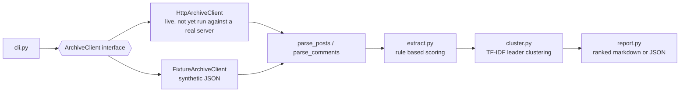

# reddit-pain-miner

**Turn a pile of forum threads into a ranked list of what customers complain about, with the quotes to back it up.**

If you are a founder or marketer doing market research, you probably read threads by hand, paste a few lines into a notes file and lose the rest.
This tool does the reading: it pulls posts and comments on a topic, keeps the sentences that are complaints, groups the ones about the same problem, and ranks the groups by how strongly and how widely people feel it.

You get one short report per topic:

- a ranked table of pain points (score, mentions, threads, distinct authors)
- two or three short quotes per pain point with source ids, so you can check every claim
- the rule names that fired on each sentence, so no score is a black box

It is plain Python with no dependencies and no AI model calls, so the same input always gives the same report.

**Status, stated plainly:** this is a working demo on synthetic data. Everything here runs offline against an invented fixture. The live archive client is written and unit tested against a fake transport, but it has never been run against a real server. See [Limitations](#limitations).

## What you will see

`python -m pain_miner --topic "invoicing software" --offline --top 4 --quotes 1` prints this (trimmed, real output):

```text
# Pain point report: invoicing software

- Threads scanned: 7
- Complaint statements kept: 44
- Clusters found: 12 (showing top 4)

| Rank | Pain point | Score | Mentions | Threads | Authors |
| --- | --- | --- | --- | --- | --- |
| 1 | bank / sync / feed | 101.79 | 7 | 2 | 6 |
| 2 | overdue / reminders / payment | 95.67 | 7 | 2 | 5 |
| 3 | receipts / mobile / crashes | 66.05 | 7 | 2 | 5 |
| 4 | price / raised / per | 64.83 | 6 | 2 | 5 |

## 1. bank / sync / feed

Signals: malfunction, first_person, intensifier

- "For me the bank sync fails about once a week and I am sick of reconnecting the bank feed." (score 7.06, 133 upvotes, source p007)
```

The posts behind this are invented (see `demo/make_fixture.py`), so read it as proof the pipeline works, not as a finding about invoicing software.

## Run it

Needs Python 3.10 or newer. Nothing to install.

```bash
git clone https://github.com/midcityhandyman/reddit-pain-miner.git
cd reddit-pain-miner
python -m pain_miner --topic "invoicing software" --offline
```

Useful flags: `--format json`, `--out report.md`, `--top 5`, `--quotes 2`, `--min-score 3`, `--similarity 0.2`, `--subreddit NAME`, `--limit 10`.

`--offline` replays `fixtures/<topic>.json`. The only fixture shipped is `invoicing software`; any other topic exits with an error that lists what is available.

Live mode (untested against a real server): copy `.env.example` to `.env`, set `PAIN_MINER_API_BASE` to an archive that serves `/api/posts/search` and `/api/comments/search`, and drop `--offline`. Without that variable the command exits with a clear error.

## How it works

1. **Fetch.** Posts and their comments come through an `ArchiveClient` interface. `FixtureArchiveClient` replays JSON from `fixtures/`. `HttpArchiveClient` is the live one. Both feed the same parser, which decodes HTML entities and skips deleted or malformed rows.
2. **Score.** Text is split into sentences (quoted `>` lines are dropped). Each sentence is checked against eight weighted rule groups: strong negative, frustration, malfunction, cost, friction, unmet need, support, limitation. A sentence needs at least one to count. Intensity words, first person voice, shouting and upvotes then adjust the score, and praise words lower it.
3. **Cluster.** Complaint sentences become TF-IDF vectors and are grouped by cosine similarity with leader clustering. Pure Python, no randomness.
4. **Rank.** A cluster's score is the sum of its sentence scores times `log2(1 + distinct authors)`, so one person repeating themselves counts for less than several people agreeing.
5. **Report.** Markdown or JSON, quotes capped at 160 characters, source ids only. Usernames are never printed.



## Tests

```bash
python -m venv .venv
.venv/bin/pip install -r requirements-dev.txt    # Windows: .venv\Scripts\pip
.venv/bin/python -m pytest -q                    # Windows: .venv\Scripts\python
```

34 tests cover the fixture client, the HTTP client (through an injected fake opener, so no sockets), the scoring rules, clustering, report rendering and the CLI. The only dev dependency is pytest. CI (`.github/workflows/ci.yml`) runs them on Python 3.10 and 3.12 and checks that the demo still reproduces `demo/output.txt` byte for byte.

## Demo

```bash
python demo/run_demo.py
```

Prints the five strongest statements with the rules that fired on each, then the top six pain points. The full captured output is in [demo/output.txt](demo/output.txt). The first lines:

```text
-- strongest complaint statements and the rules that fired --
 8.25  [frustration, friction, unmet_need, first_person]
       I wish there was a way to escalate overdue reminders after 30 days, chasing clients by hand is painful.
 7.06  [strong_negative, malfunction, first_person]
       For me the bank sync fails about once a week and I am sick of reconnecting the bank feed.
```

## Background

The shape (a source behind an interface, fixtures for offline runs, explainable rule scoring before clustering, a report a person can skim) follows a pattern the author uses in private tooling for picking which customer problems to write about. This repo is a standalone rewrite with invented data. It has no users and no production history of its own.

## Limitations

What is mocked or unproven:

- **No live run.** `HttpArchiveClient` has only been exercised against a fake transport in tests. It has never called a real archive from this repo. It has no retries, paging or rate limiting, and the endpoint paths and parameter names (for example `link_id` with or without a `t3_` prefix) may need adjusting for a given archive.
- **Synthetic data only.** The one fixture (7 threads, 32 comments, 29 made up authors) was written for this repo with clear themes in it, so the demo is cleaner than real threads would be. Accuracy on real forum text has not been measured. There is no labelled test set, and no precision or recall figure.
- **Scale is untested.** Clustering compares every statement with every cluster centroid in pure Python. That is fine for the few hundred statements one topic produces. It has not been timed on large pulls.

What the method cannot do:

- The rules are English only and keyword based. Sarcasm, negation ("not broken anymore", "would not recommend") and complaints phrased without trigger words are missed or misread.
- Sentences are scored in isolation, so a fragment can be kept without its context and may form a meaningless one item cluster.
- Clustering is lexical. Two complaints about the same problem in different words land in different clusters. Labels are just the top three terms, and the stemmer is a crude suffix stripper.
- Leader clustering depends on input order (strongest statements seed the clusters). It is deterministic, not optimal.
- Scores are relative within one report. They are not comparable across topics and are not a market size.
- Exact duplicate sentences are counted once, and deleted accounts that share a placeholder name count as one author.
- Output is a research aid. Counts reflect who posts, not the whole market.

License: MIT, see the LICENSE file.
